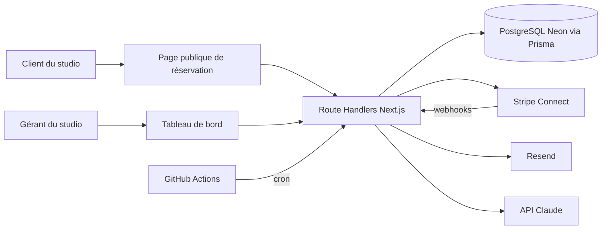

# ZenBook : étude de cas

> SaaS B2B de gestion et de réservation pour studios de pilates indépendants. En production sur [zenbook.fr](https://zenbook.fr).

Conçu, développé et déployé seul, de bout en bout. Le code source est privé : ce dépôt présente le produit, l'architecture et les choix techniques.

## Le produit

Les studios gèrent leurs créneaux, leurs clients et leurs paiements depuis un tableau de bord, et disposent d'une page publique de réservation à leurs couleurs, sans application à télécharger. Les clients réservent et paient en ligne, reçoivent une confirmation puis un rappel la veille, et peuvent annuler depuis un lien reçu par email.

## Stack

| Couche | Technologies |
|---|---|
| Front | Next.js 16 (App Router, Turbopack), React 19, TypeScript 5, Tailwind CSS |
| Back | Route Handlers Next.js, Prisma, PostgreSQL (Neon serverless), Zod |
| Auth | Clerk, sessions et magic links signés (jose) |
| Paiements | Stripe (abonnements) et Stripe Connect Express |
| Emails | Resend et React Email |
| Infra | Vercel, Upstash Redis, GitHub Actions |
| Qualité | Playwright, Vitest, Sentry, ESLint, TypeScript strict |

## Architecture

## Choix techniques

### Paiements Stripe sur deux niveaux

ZenBook facture les studios par abonnement (Standard, Premium), et chaque studio possède son propre compte Stripe Connect Express pour encaisser directement ses clients. ZenBook ne prend aucune commission.

Chaque niveau a son propre endpoint de webhook et son propre secret de signature :

- **compte ZenBook** : création, mise à jour et résiliation des abonnements ;
- **comptes connectés** : validation KYC du studio, paiement réussi (crédit du solde client, création automatique de la réservation, email), échec de paiement (notification du client et du studio).

### Multi-tenant

Un compte Clerk correspond à un utilisateur et à un studio. Toute route protégée résout le studio courant par une fonction unique, ce qui isole les données de chaque studio. Les entrées sont validées par des schémas Zod centralisés.

### Sécurité

- Sessions client, magic links et liens d'annulation signés avec un secret dédié.
- Rate limiting sur les routes publiques avec Upstash Redis.
- Endpoints de cron protégés par un secret, qui refusent toute requête sans lui.

### Tâches planifiées et IA

Le plan gratuit de Vercel limite les crons à un par jour. Le rappel horaire de la veille est donc déclenché par un workflow GitHub Actions qui appelle l'endpoint avec un jeton. D'autres tâches planifiées génèrent avec l'API Claude des briefings hebdomadaires et des bilans mensuels pour les gérants.

## Qualité

- Tests E2E Playwright sur le parcours complet : inscription, onboarding en 4 étapes, achat depuis la page publique, réception de l'email, annulation depuis le lien.
- Tests unitaires et d'intégration avec Vitest.
- Monitoring des erreurs avec Sentry.
- Lint et vérification de types stricte.

## Contact

Ayoub Lafdail · [lafdail.dev](https://lafdail.dev) · [LinkedIn](https://www.linkedin.com/in/lafdail)
